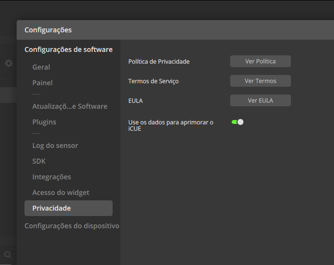
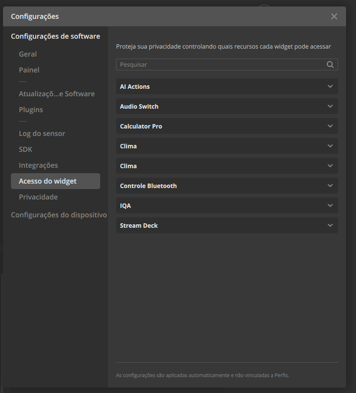
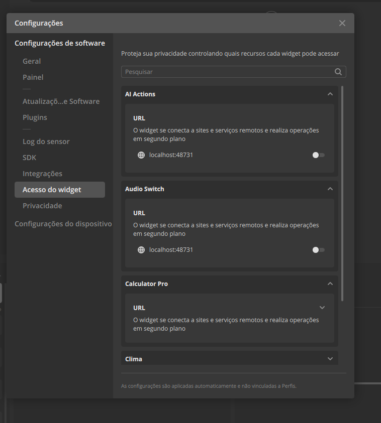
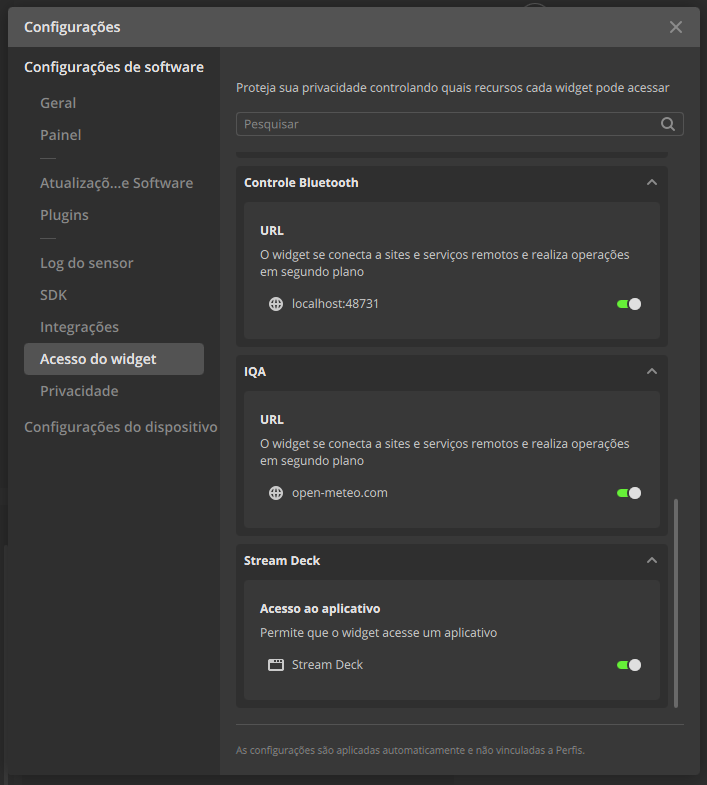

# ChagasMarket Widgets — CORSAIR XENEON EDGE

🇧🇷 [Português](#português) · 🇺🇸 [English](#english)

---

## Português

Widgets do iCUE da **ChagasMarket** para a **CORSAIR XENEON EDGE**. Os widgets estão no **Elgato Marketplace**; aqui
fica o **ChagasMarket Bridge**, o app gratuito que eles usam para acessar o Windows.

### Download do ChagasMarket Bridge

Baixe o **[ChagasMarketBridge-bridge-Setup.exe](../../releases/latest/download/ChagasMarketBridge-bridge-Setup.exe)**
(ou veja o **[Release mais recente](../../releases/latest)**). Um único app serve para todos os widgets da ChagasMarket.

1. Rode o Setup. Ele instala sem pedir administrador, abre com o Windows, fica na bandeja e se atualiza sozinho.
   - Se aparecer **"O Windows protegeu o computador"**, clique em **Mais informações → Executar assim mesmo**.
2. Instale o widget pelo Elgato Marketplace (ou, se tiver o arquivo, no iCUE em **Widgets → +** e escolha o `.icuewidget`).
3. No iCUE 5.52 ou mais novo, **libere o acesso do widget** (veja abaixo).

### ⚠️ iCUE 5.52 ou mais novo: libere o acesso dos widgets

A partir do iCUE 5.52, cada widget precisa da sua permissão para falar com o ChagasMarket Bridge. O iCUE pergunta uma
única vez, num aviso que some em poucos segundos; se ele sumir, o widget mostra **"App ChagasMarket Bridge não
encontrado"** mesmo com o app aberto. Para liberar:

1. No iCUE, clique na **engrenagem ⚙️** (canto superior direito) → **Configurações de software** → **Acesso do widget**.

   

2. Aparece a lista de widgets, toda fechada. **É preciso entrar em um por um**: AI Actions, Audio Switch, Calculator Pro
   e Controle Bluetooth (só os que você usa).

   

3. **Em cada widget**, clique no nome para abrir e **habilite a chave de `localhost:48731`**. Se o bloco **URL** estiver
   fechado, clique na setinha **⌄** para ver a chave. Depois feche e passe para o próximo widget.
   - No **Calculator Pro** são **duas chaves**: `localhost:48731` e `api.frankfurter.dev` (cotações das moedas).

   

4. Confira: em todos os widgets da ChagasMarket as chaves ficam **verdes**. Vale na hora, sem reiniciar; em poucos
   segundos cada widget conecta.

   

### Widgets

| Widget | O que faz | Precisa do app? |
|---|---|---|
| **[Audio Switch](https://marketplace.elgato.com/product/audio-switch-c350ee25-ebb5-499b-b077-ffbe44b9f011)** | Troca a saída e a entrada de áudio padrão com um toque e ajusta o volume e o mudo | Sim |
| **[Calculator Pro](https://marketplace.elgato.com/product/calculator-pro-9c4fca8d-5c28-477f-ab58-3af14b6ee955)** *(grátis)* | Calculadora, conversor de moedas e de medidas | Só para Copiar e Digitar o resultado |
| **Bluetooth Control** *(em breve)* | Lista os dispositivos Bluetooth e liga/desliga o Bluetooth do PC e cada dispositivo com um toque | Sim |

### Por que um app?

Widgets do iCUE rodam isolados e não acessam recursos do Windows, como Bluetooth, áudio e digitação. O ChagasMarket
Bridge faz esse papel e só aceita conexões do próprio PC (`127.0.0.1`) vindas dos widgets no iCUE. Ele não envia nada
pela internet; só procura atualização ao abrir.

### Suporte

- 🐞 Abra um chamado em **[Issues](../../issues)**

Ajuda a resolver mais rápido: o nome do widget, o que aconteceu e, se puder, o log do app, que fica em
`%LOCALAPPDATA%\ChagasMarketBridgeData\bridge.log` (no menu do ChagasMarket Bridge na bandeja: **Abrir pasta de logs**).

### Requisitos

- Windows 10 ou 11
- iCUE 5.47 ou mais novo
- CORSAIR XENEON EDGE

---

## English

iCUE widgets by **ChagasMarket** for the **CORSAIR XENEON EDGE**. The widgets are on the **Elgato Marketplace**; this
page hosts **ChagasMarket Bridge**, the free app they use to reach Windows.

### Download ChagasMarket Bridge

Download **[ChagasMarketBridge-bridge-Setup.exe](../../releases/latest/download/ChagasMarketBridge-bridge-Setup.exe)**
(or see the **[latest Release](../../releases/latest)**). One app serves every ChagasMarket widget.

1. Run the Setup. It installs without admin rights, starts with Windows, lives in the tray and updates itself.
   - If **"Windows protected your PC"** shows up, click **More info → Run anyway**.
2. Install the widget from the Elgato Marketplace (or, if you have the file, in iCUE open **Widgets → +** and pick the `.icuewidget`).
3. On iCUE 5.52 or newer, **allow widget access** (see below).

### ⚠️ iCUE 5.52 or newer: allow widget access

Starting with iCUE 5.52, each widget needs its own permission to talk to ChagasMarket Bridge. iCUE asks only once, in a
notice that disappears after a few seconds; if it goes away, the widget shows **"ChagasMarket Bridge app not found"**
even with the app running. To allow it:

1. In iCUE, click the **gear ⚙️** (top right) → **Software Settings** → **Widget Access**.

   

2. The widget list shows up, all collapsed. **You need to open them one by one**: AI Actions, Audio Switch, Calculator
   Pro and Bluetooth Control (only the ones you use).

   

3. **In each widget**, click its name to open it and **turn on the `localhost:48731` switch**. If the **URL** block is
   collapsed, click the **⌄** arrow to see the switch. Then close it and move on to the next widget.
   - **Calculator Pro** has **two switches**: `localhost:48731` and `api.frankfurter.dev` (currency rates).

   

4. Check: on every ChagasMarket widget the switches turn **green**. It applies right away, no restart needed; each widget
   connects within a few seconds.

   

*(Screenshots from iCUE in Portuguese; the menus are in the same place in English.)*

### Widgets

| Widget | What it does | Needs the app? |
|---|---|---|
| **[Audio Switch](https://marketplace.elgato.com/product/audio-switch-c350ee25-ebb5-499b-b077-ffbe44b9f011)** | Switches the default audio output and input with a tap and adjusts volume and mute | Yes |
| **[Calculator Pro](https://marketplace.elgato.com/product/calculator-pro-9c4fca8d-5c28-477f-ab58-3af14b6ee955)** *(free)* | Calculator, currency converter and unit converter | Only to Copy and Type the result |
| **Bluetooth Control** *(coming soon)* | Lists Bluetooth devices and turns the PC's Bluetooth, and each device, on and off with a tap | Yes |

### Why an app?

iCUE widgets run sandboxed and cannot reach Windows features such as Bluetooth, audio and typing. ChagasMarket Bridge
does that job and only accepts local connections (`127.0.0.1`) coming from the widgets inside iCUE. It sends nothing
over the internet; it only checks for updates when it starts.

### Support

- 🐞 Open a ticket in **[Issues](../../issues)**

To get help faster, include the widget name, what happened and, if you can, the app log at
`%LOCALAPPDATA%\ChagasMarketBridgeData\bridge.log` (in the ChagasMarket Bridge tray menu: **Open log folder**).

### Requirements

- Windows 10 or 11
- iCUE 5.47 or newer
- CORSAIR XENEON EDGE
